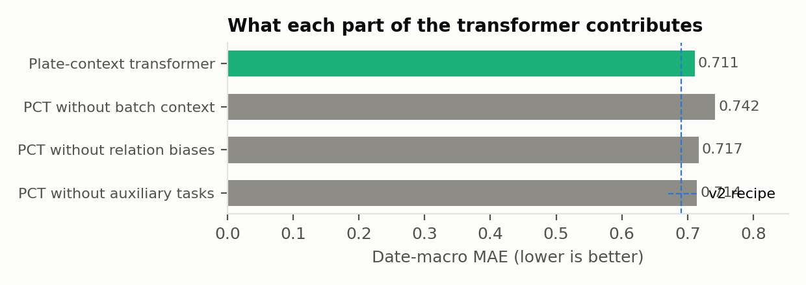
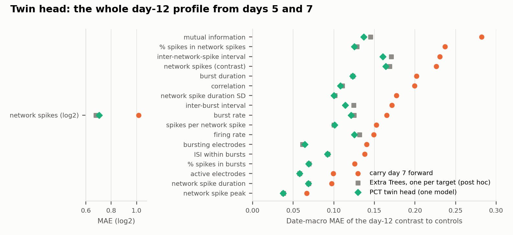
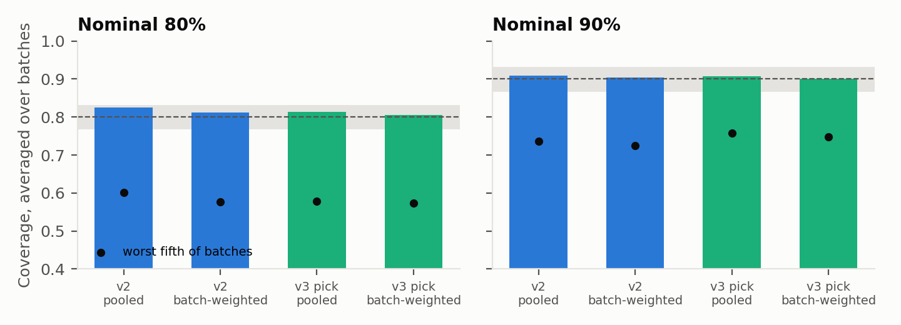

# NeuroForecast v3: a model study on all 41 public batches

**What this is.** Both sealed tests are spent: the 3-batch reserve (September 21) and the 24-batch external test (September 27). v3 asks a development question under one locked protocol: does modern machine learning beat the shipped v2 model, and does a new architecture add anything? Every number here comes from nested, chemical-purged, batch-grouped cross-validation over data the author has already seen. None of it is a sealed test.

**Answer in one paragraph.** Across 19 candidates, simple tree ensembles remain the strongest single family at this data size; LightGBM, TabPFN v2, an MLP and ridge all scored worse than v2's Extra Trees. The new plate-context transformer (PCT) reads a whole culture batch at once. Alone, it scored worse than v2 overall (0.711 against 0.690), but better on the 24 older external batches (0.623 against 0.663). Removing its batch context was the most damaging ablation (0.742), though that interval includes zero. Averaged with v2, it gave the best descriptive score (0.668, better on 30 of 41 batches). Once model selection is included, however, the nested v3 estimate (0.695) shows no gain over v2. **The locked swap rule therefore failed, and v2 stays the shipped model.** The PCT's twin head forecasts the whole day-9 and day-12 functional profile (36 targets) from one model. It beats carry-forward on all 36 and is about as accurate as 36 separately trained Extra Trees models (post hoc).

Protocol: [`experiments/neuroforecast_v3_protocol.json`](../experiments/neuroforecast_v3_protocol.json). Code: `tools/neuroforecast_v3_{data,pct,run,analyze}.py`, `tools/run_neuroforecast_v3.sh`, `tests/test_neuroforecast_v3.py`. Post hoc: `tools/neuroforecast_v3_posthoc.py`. Figures: `tools/report_v3_figures.py`. Outputs, predictions and per-case evidence: `evaluation/v3/` in the public repository.

## Timeline and audit trail

| Time (IST) | Event |
| --- | --- |
| Oct 7, 21:56 | Pooled benchmark prepared from the EPA refinement release: 2,285 conditions, 2,243 usable, 41 batches with eligible conditions, 243 chemicals, 169 plates, 7,900 wells. |
| Oct 7, 21:56–22:35 | Engineering checks on the four inner folds of outer fold 0 only (listed in the protocol's disclosure). No outer-fold prediction existed. |
| Oct 7, 22:37:08 | Lock written (`lock_v3.json`): protocol SHA-256 `034a5bd7…8349`, prepared-data manifest, and hashes of ten code files. Every later stage refuses to run if any hash differs. |
| Oct 7, 22:38 | Tabular candidates done (62 s, 16 CPU workers). |
| Oct 7, 23:48 | The job monitor on the author's machine stopped tracking the run script to free memory. The script itself kept running. |
| Oct 8, 00:09 | PCT done (45 splits × 5 seeds, 5,458 s, deterministic CUDA). |
| Oct 8, 00:48 | TabPFN v2 done. |
| Oct 8, 01:58 | Ablations done (3 × 45 outer trainings). |
| Oct 8, 02:00 | Analysis written (`analysis/results.json`, `analysis/outer_case_table.csv`). |
| Oct 8, 03:39–04:00 | A redundant restart, made in the belief that the run had stopped, re-ran TabPFN on one candidate before it was stopped. Its output reproduced the original exactly: all nine inner-fold scores were identical, and outer predictions agreed to 4e-16. No other output was touched. |

## Data and design

- **Source.** USEPA/CompTox-DNT-NFA-Refinement @01adf3e, `All_DIV_Data.Rdata`. All 45 dates were pooled in one consistent processing (no `cv.time`/`cv.network`; adds `mi`). Four dates contribute no eligible condition.
- **Target and usability.** These are the v2 rules: day-12 log2 replicate-mean network spikes relative to same-plate day-12 controls, scored where the day-12 control median is at least 5.
- **Folds.** Nine outer folds interleave the 41 sorted dates (4–5 batches each, so every fold spans 2014–2017). Inside each outer training set are four interleaved inner folds. At both levels, every condition of a held-out chemical is removed from training; for the PCT, its labels are masked. A test confirms no chemical crosses a split.
- **Metric.** The metric is date-macro MAE: error averaged within chemical, then over chemicals within a batch, then over batches. Comparisons use a paired bootstrap over batches (10,000 resamples).
- **Nested selection.** In each outer fold, the candidate with the lowest inner score supplies that fold's outer predictions. The pooled result is the honest estimate of "choose the best v3 model".

### Candidates

| Family | Candidates |
| --- | --- |
| Trivial | Carry day 7 forward, predict no effect |
| Incumbent | v2 recipe: Extra Trees on 13 day-5/day-7 activity and coordination features |
| Trees + new context | Extra Trees with **batch context** (9 descriptors of how the batch's controls are maturing and how persistent effects already are between days 5 and 7), with all features + context, or with **dose-series context** (7 descriptors of the same chemical's other doses on the same batch) |
| Other learners | Ridge, LightGBM (two feature sets), MLP |
| Tabular foundation model | TabPFN v2 (Hollmann et al., *Nature* 2025), two feature sets |
| New architecture | **Plate-context transformer (PCT)**, plus three ablations: no batch context, no relational biases, no auxiliary tasks |
| Ensembles | v2 + PCT; v2 + LightGBM + TabPFN; v2 + LightGBM + TabPFN + PCT |

### The plate-context transformer

- **Tokens.** Each physical well of a batch is one token, built from its day-5 and day-7 readouts only: 17 readouts, their contrast to same-plate controls and their missingness, plus relative network spikes, dose and well position. A batch has 31–288 tokens, covering every plate, every control and every treated well.
- **Attention.** Attention runs across the whole batch. Learned biases mark wells that share a plate, a chemical or a condition. No identity, date or plate label enters, so the model is permutation-equivariant over wells, plates and chemicals.
- **Condition head.** The mean embedding of a condition's wells, joined with v2's 13 condition features, predicts the 10th, 50th and 90th percentiles of the day-7-to-day-12 change. The median is the forecast.
- **Twin head.** The same pooled embedding predicts 36 later-day targets: day-9 and day-12 relative network spikes, and the control contrast of all 17 readouts at both days.
- **Auxiliary head.** Every well, controls included, predicts its own day-9 and day-12 readouts, giving a multi-task signal about how cultures develop.
- **Training.** d = 128, 4 layers, 4 heads, 200 epochs, AdamW. Augmentation drops whole plates (p = 0.15) and treated wells (p = 0.10). Five seeds are averaged at both levels.
- **Determinism.** CUDA runs in deterministic mode: two identical runs differed by exactly 0.0, and a replay of outer fold 0 matched the saved forecasts at float32 precision (see post hoc).

## Results (41 batches, outer folds, usable conditions)

| Candidate | Date-macro MAE | Minus v2 | Paired 95% interval | Batches better than v2 (of 41) |
| --- | ---: | ---: | --- | ---: |
| v2 + PCT ensemble | **0.668** | −0.022 | −0.060 to +0.020 | **30** |
| v2 + LightGBM + TabPFN + PCT | 0.674 | −0.016 | −0.051 to +0.022 | 27 |
| Extra Trees + dose-series context | 0.679 | −0.011 | −0.038 to +0.014 | 22 |
| Extra Trees, all features + batch context | 0.680 | −0.010 | −0.049 to +0.026 | 19 |
| Extra Trees + batch context | 0.684 | −0.007 | −0.040 to +0.025 | 21 |
| **v2 recipe (incumbent)** | **0.690** | — | — | — |
| v2 + LightGBM + TabPFN | 0.693 | +0.003 | −0.026 to +0.033 | 24 |
| **Nested v3 (selection included)** | **0.695** | +0.004 | −0.038 to +0.050 | 25 |
| PCT | 0.711 | +0.020 | −0.059 to +0.107 | 21 |
| LightGBM (all / small) | 0.718 / 0.722 | +0.027 / +0.031 | — | 21 / 22 |
| TabPFN v2 (all / small) | 0.723 / 0.734 | +0.033 / +0.044 | — | 18 / 18 |
| MLP | 0.862 | +0.171 | +0.093 to +0.268 | 9 |
| Ridge | 0.880 | +0.190 | +0.104 to +0.295 | 9 |
| Carry day 7 forward | 1.016 | +0.326 | +0.219 to +0.446 | 4 |

Every individual row except the nested estimate is post-selection and descriptive. The nested procedure picked the v2 + PCT ensemble in three folds, the four-model ensemble in five and TabPFN in one. In every fold, the inner score of the pick beat v2's. That disagreement between folds is the cost of choosing among 19 candidates, and the nested estimate pays it.

### The locked swap rule

| Check | Required | Observed | Pass |
| --- | --- | --- | --- |
| Gain over v2 | ≥ 5% | −0.6% | no |
| Paired interval below zero | upper bound < 0 | +0.050 | no |
| Better on ≥ 55% of batches | ≥ 23 of 41 | 25 | yes |
| Trust AURC within 2% of v2 | ≤ 0.507 | 0.465 | yes |

**v2 stays the shipped model.** v3 is reported as a development finding.

### Where the transformer helps: the two cohorts

| Cohort | Batches | v2 | PCT | v2 + PCT | Ensemble minus v2, 95% | Ensemble better on |
| --- | ---: | ---: | ---: | ---: | --- | ---: |
| 2016–17 archive | 17 | 0.728 | 0.834 | 0.744 | −0.048 to +0.102 | 10 of 17 |
| 2014–16 external | 24 | 0.663 | 0.623 | **0.614** | **−0.092 to −0.009** | **20 of 24** |

On the older 24 batches, adding the PCT to v2 helps with an interval that excludes zero. On the 17 archive batches it does not. This cohort split was not pre-specified, so it is post hoc and descriptive. The archive includes the collapsed-control batch 20171004 and the persistent reserve batches, where the earlier sealed tests already showed unusual behaviour.

### What each part of the transformer contributes

| Variant | Date-macro MAE |
| --- | ---: |
| PCT (full) | 0.711 |
| without batch context (each well attends only to itself) | 0.742 |
| without relational biases | 0.717 |
| without auxiliary well and twin tasks | 0.714 |

The batch-blind variant is the worst: removing batch context costs +0.032 and is worse on 26 of 41 batches, but the paired interval (−0.012 to +0.079) includes zero. Relational biases (+0.006) and the auxiliary tasks (+0.003) add little. Batch context is the largest effect, not a proven one.

### Twin head: the whole day-12 functional profile

The twin head beats carry-forward on all 36 later-day targets. For example, day-12 network spikes score 0.704 against 1.016, mutual information 0.137 against 0.282, and correlation 0.108 against 0.199. Against a fair learned baseline (post hoc: one Extra Trees per target, same folds and inputs), it is about equal. It wins 16 of 36 targets, with a mean error ratio of 1.02. The intervals favour Extra Trees on 4 day-9 targets and the PCT on 1 day-12 target (inter-burst interval). The twin head's contribution is one jointly trained model for the whole profile, not higher accuracy than dedicated models.

### Intervals under batch shift

| Product | Method | Coverage at 0.80 (batch mean / worst fifth) | Coverage at 0.90 (batch mean / worst fifth) |
| --- | --- | --- | --- |
| v2 | pooled (the v2 method) | 0.824 / 0.601 | 0.910 / 0.737 |
| v2 | batch-weighted | **0.812** / 0.577 | **0.904** / 0.725 |
| v2 + PCT | pooled | 0.813 / 0.579 | 0.907 / 0.757 |
| v2 + PCT | batch-weighted | **0.805** / 0.573 | **0.902** / 0.749 |

Calibrated on outer training folds that span 2014–2017, the intervals are on target on average: every batch-mean coverage lies inside the protocol's success band of ±0.03. Batch-weighting moves them closer to nominal and makes them narrower (mean width 2.34 against 2.42 at 0.80 for v2). The worst fifth of batches still sees about 0.58 at 0.80. Average coverage is therefore fixable by calibrating across many batches; per-batch coverage is not guaranteed. The external test's 0.70 came from calibrating on 17 batches and applying the intervals to a different period.

### Trust, abstention and warning

- **Trust.** On 41 batches, the learned difficulty score ranks errors better than the extremity rule for every product: AURC 0.497 against 0.512 for v2, and 0.465 against 0.476 for v2 + PCT.
- **Abstention.** Declining the 20% least trusted conditions cuts v2's mean error by 32%: 0.480 kept against 0.703 overall. The declined conditions average 1.595.
- **Early warning** (still quiet at day 7, later large change, 20% budget per batch, 131 positives): ranking by the nested v3 forecast's predicted change finds 50.0, v2 43.3, highest dose first 41.6, day-7 magnitude 35.9 and chance 28.5. This is descriptive. The sealed external test failed this criterion, so no warning claim is made.

## v3.1: coverage per culture batch

The worst-fifth coverage gap prompted a second, separately fixed protocol. [`experiments/neuroforecast_v31_interval_protocol.json`](../experiments/neuroforecast_v31_interval_protocol.json) (SHA-256 `6e24a74a…e6c1`) was written before any v3.1 interval was computed. The code is `tools/neuroforecast_v31_intervals.py`. It uses the v2 recipe's locked v3 forecasts on all 41 batches, so it is a development comparison.

| Method | 0.80: batch mean / worst fifth / width | 0.90: batch mean / worst fifth / width | Batches within 0.1 of nominal (0.80 / 0.90) |
| --- | --- | --- | --- |
| Pooled (v2 method) | 0.824 / 0.601 / 2.42 | 0.910 / 0.737 / 3.22 | 83% / 85% |
| Batch-weighted (v3) | 0.812 / 0.577 / 2.34 | 0.904 / 0.725 / 3.12 | 80% / 85% |
| Batch-adaptive (predicted batch difficulty) | 0.823 / 0.603 / 2.47 | 0.926 / 0.801 / 3.42 | 83% / 90% |
| **Two-level (assurance)** | 0.878 / **0.680** / 2.93 | 0.948 / **0.829** / 3.74 | **90% / 93%** |

- **Batch-adaptive intervals failed their pre-set bar.** The worst fifth rose by 0.026 against the required 0.05, at 6% more width. The batch multiplier, predicted from day-5 and day-7 batch summaries on top of the per-condition difficulty score, did not track realised batch error: rank correlation −0.07 on the held-out batches. *Correction, October 8, 2026:* an earlier version of this page said that a batch's difficulty cannot be predicted at day 7. That overstated the result. The per-condition difficulty score, averaged over a batch, does rank batches by realised error (rank correlation 0.65 on these 41 batches and 0.60 on the 24 external ones; post hoc, `tools/posthoc_calibrated_day7.py`). What could not be predicted is the further batch-level shift that remains after it.
- **Two-level calibration buys batch-level assurance at a known price.** At nominal 0.80, 90% of batches get at least 0.70 coverage and the worst fifth rises from 0.58 to 0.68, but intervals are 25% wider than batch-weighted ones. At 0.90 the worst fifth reaches 0.83, for 20% more width. For a lab that needs every batch covered, this is the honest option; average-only coverage is cheaper.

## Post hoc (`tools/neuroforecast_v3_posthoc.py`, not in the protocol)

- **Ablations against the full PCT**, paired over 41 batches:

  | Ablation | Minus PCT | Paired 95% interval | Batches where the ablation is worse |
  | --- | ---: | --- | ---: |
  | No batch context | +0.032 | −0.012 to +0.079 | 26 |
  | No relational biases | +0.006 | −0.010 to +0.021 | 24 |
  | No auxiliary tasks | +0.003 | −0.027 to +0.030 | 21 |

- **Twin baseline.** An earlier draft compared the twin head with one multi-output Extra Trees and reported that the PCT won 30 of 36 targets. That baseline was unfair: a joint fit keeps only training cases where all 36 targets exist, which discarded much of the data, and it scored worse than carry-forward on network spikes. Rerun with one Extra Trees per target on all available cases, the comparison is about equal (16 of 36). Only the fair comparison is reported above.
- **Cohorts.** These are the table in the results section above. The cohort split was chosen after the main results were seen.
- **Replay.** Retraining the PCT on outer fold 0 with the locked code and seeds reproduced all 265 saved forecasts exactly in float32. The saved CSV stores float32 values at their round-trip precision, so the largest float64 difference was 2.4e-7.

## What this changes in the submission

- v2 remains the product. Its two sealed results are unchanged.
- The technical report gains a model-study section. It shows that, at 2,243 conditions, careful tree ensembles beat a tabular foundation model, boosting and neural nets. It also tests a batch-context transformer (standard attention with learned same-plate, same-chemical and same-condition biases), whose value lies in batch context and profile forecasting rather than raw accuracy.
- The transformer is the most concrete path to a future version: on the older batches, its ensemble with v2 helps with an interval that excludes zero, but a prospective sealed test is needed before it ships.
