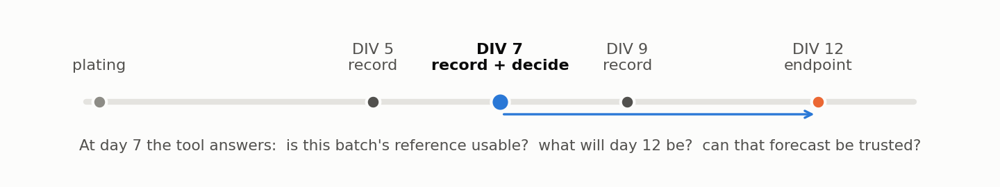
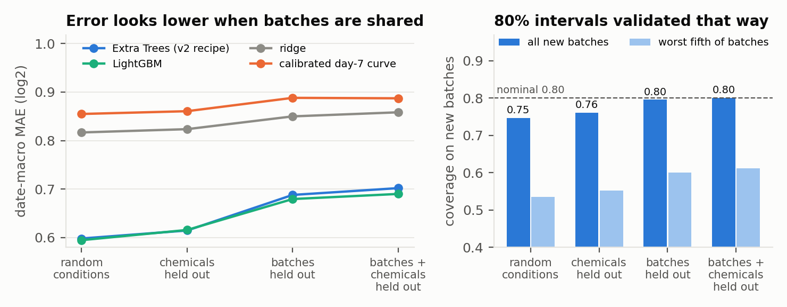
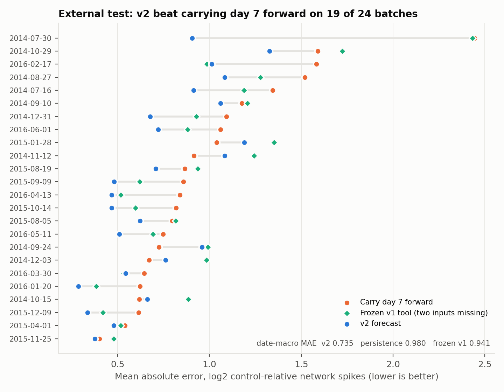
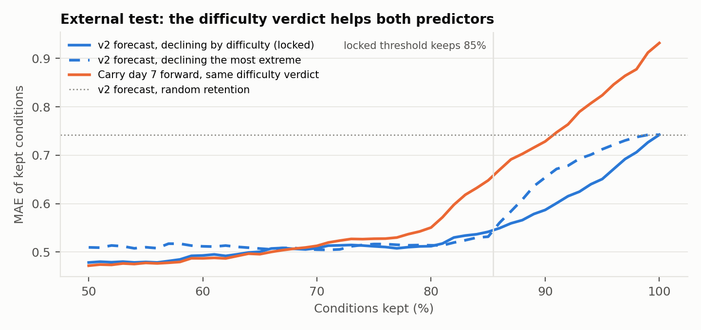
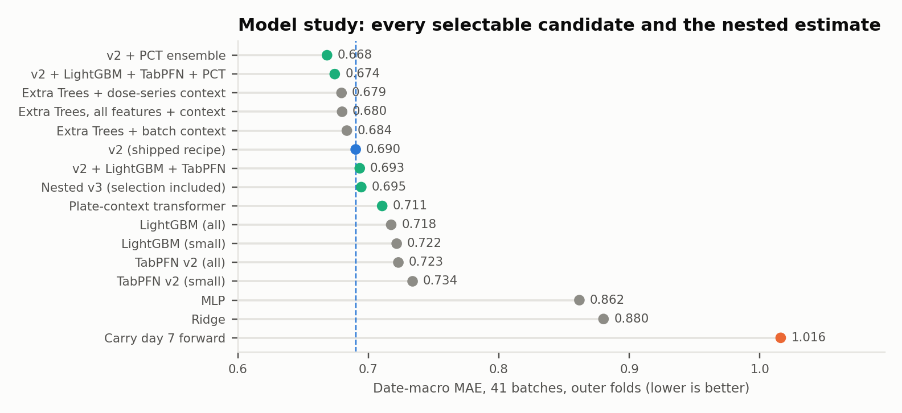
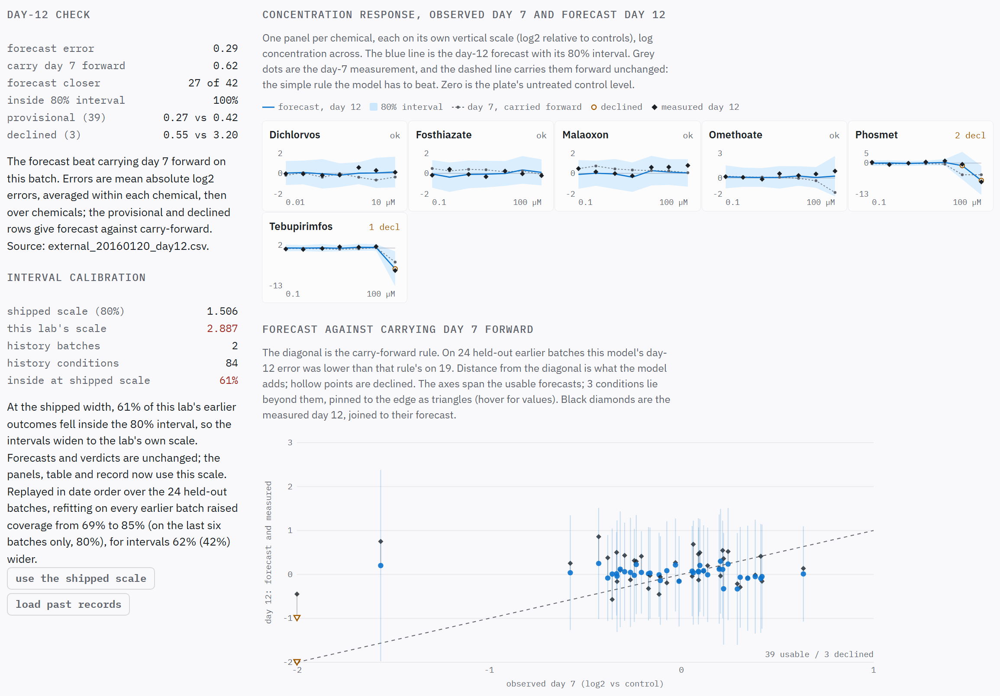
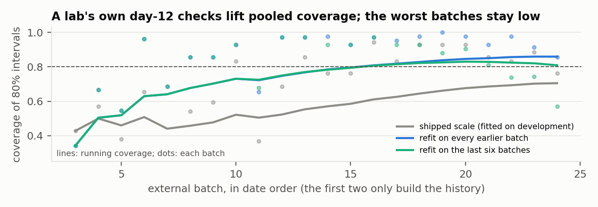

# NeuroForecast: a validation and trust layer for AI on neural MEA assays

*A public validation harness that holds out culture batches, a publicly pre-registered study of how weaker splits flatter forecasters, and a day-7 tool that refuses, checks itself at day 12 and recalibrates from the lab's own results; plus a first path for chip spike data.*

**Submission category: Tool & Platform.**
AI4S Open Innovation: AI for Life Science (AI + Organ-on-a-Chip), 5th Pazhou Algorithm Competition.
Team: one person (GitHub [SaltyTaro](https://github.com/SaltyTaro)).
Code, models and evidence: <https://github.com/SaltyTaro/neuroforecast>.
Live tool (runs in the browser, no login): <https://saltytaro.github.io/neuroforecast/app/>.

---

## Summary

Neuronal networks grown on microelectrode arrays (MEAs) are the only functional assay in the developmental-neurotoxicity in-vitro battery, and neural organ chips record the same kind of data. AI can forecast how such a network will develop, but every culture batch behaves differently, and each new chip run is a new batch. Two questions decide whether a forecast is worth using:
- How good is the forecaster on a batch it has never seen?
- At the bench, which of today's forecasts can be trusted?

NeuroForecast answers both on public EPA data: 41 culture batches, 2,243 conditions, 243 chemicals.

**1. Validation: a harness that holds out culture batches, and what weaker splits hide (§6).** The harness fixes folds for four split designs and scores any forecaster against carry-forward and a calibrated day-7 curve on the same conditions. A locked study compared the designs with five models and five fold repetitions. Its protocol was committed publicly before the first run, after a disclosed one-model probe had already shown the effect.

| Validation design | Extra Trees error (date-macro MAE) | Lower than the reference design by | 80% intervals validated this way, on new batches |
| --- | ---: | ---: | ---: |
| Random conditions | 0.598 | 15% | 0.75 |
| Chemicals held out | 0.615 | 12% | 0.76 |
| Batches held out | 0.688 | 2% | 0.80 |
| **Batches and chemicals held out (reference)** | **0.702** | — | 0.80 (by construction) |

- **What flatters a model is sharing culture batches, not familiar chemicals.** Holding out batches alone recovers almost all of the gap.
- **Flexible models are flattered most.** The learned model's edge over a calibrated day-7 curve is 29–30% under random or chemical splits and 21% under batch and chemical hold-out.
- **Mixing years within a fold flatters too (post hoc, §6.3).** Trained only on the other period, as in the sealed external test, the same recipe errs 10% more on the same 24 batches (0.731 against 0.659). Seven points of that remain when the number of training batches is matched, and the edge over the calibrated curve falls to 11%.
- **Anyone can score a forecaster on these splits** with `tools/score_predictions.py`.

**2. Trust at the bench: a day-7 tool that knows when not to forecast (§7–§10).** From the day-5 and day-7 wells of a 12-day assay it gives:
1. **a batch check:** is the control reference usable?
2. **a provisional read:** a day-12 forecast with an 80% interval, always beside "carry day 7 forward";
3. **a refusal:** which conditions day 12 must decide;
4. **a day-12 self-check and an admission record**, with model and input hashes;
5. **recalibration** of the intervals from the lab's own checked records.

It runs in the browser and as a command-line tool. Their forecasts and verdicts are bit-identical, and their checks agree to within 1e-13.

| Sealed test | Batches | Conditions | Forecast MAE | Carry day 7 forward | Result |
| --- | ---: | ---: | ---: | ---: | --- |
| External: earlier batches, 105 never-seen chemicals (**v2, shipped**) | 24 | 927 | **0.735** | 0.980 | forecast **won**, 19 of 24 batches |
| Reserve: three later batches (v1, retired) | 3 | 224 | 0.7716 | **0.6088** | forecast **lost** |

- **Refusal works, but simply.** The 15% the tool refused carried 38% of all error, and declining them cut error on the rest by 27%, and by 30% for carry-forward. Every refused condition had already collapsed at day 7 (at or below −1.30 log2), and declining the most extreme forecasts does as well.
- **On the conditions it keeps, the forecast only ties a calibrated day-7 curve** (0.541 against 0.554). Half of its gain over carry-forward (49%) sits in the conditions it refuses. Across 41 batches its clear gain over the curve is on conditions collapsed at day 7 (1.41 against 2.02), which are exactly the ones it refuses; elsewhere it is 9–11% better, with intervals that include zero.
- **It does not improve a day-7 call.** For "no 2-fold change by day 12", its negative predictive value is 0.864 against 0.876 for reading day 7. When its interval excludes "no change" it was right 33 times out of 33, but that happens for only 4% of kept conditions. At day 7, the trust layer is worth more than the forecaster.
- **Intervals under-covered on new batches,** 0.70 at a nominal 0.80. Recalibrating from the lab's own day-12 checks was replayed in date order over the 24 batches:
  - refitting on every earlier batch (the primary rule) raised pooled coverage to 0.85, with intervals 62% wider;
  - refitting on the last six batches gave 0.80, with intervals 42% wider;
  - the worst fifth of batches stayed near 0.53–0.55.

  A constant widening chosen with hindsight does as well. What the lab learns is one inflation factor: the primary rule's final scale (1.97) matched the hindsight value (1.98).

**3. A path for chips, ingestion only (§11).** A converter turns spike times into 16 of the tool's 17 readouts and compares them with EPA's control wells. We ran it on a public four-compartment hippocampal chip: 10 recordings from 9 untreated cultures, days 21–37.
- 59% of readout values fall inside the range of EPA's day-12 control wells, and network readouts fit worst. The gap mixes tissue, culture age and our approximate readout definitions.
- The archive has no vehicle chips, so no real reference check was possible.
- The output cannot enter the tool yet: it has no `mi`, and no plate, treatment or concentration columns.

This shows the data path, not chip validation.

**What is new.** The learners are not: Extra Trees, conformal intervals and abstention are standard. What is new is:
- a public validation harness and scorer for neural MEA forecasting, with batch-held-out splits and the measured cost of weaker ones. Its labels are public, so scores are self-reported: it is a shared yardstick, not a blind leaderboard;
- a closed day-7-to-day-12 trust loop: refusal, self-check, admission record and recalibration, tested in the browser and in Python;
- the evidence: two sealed tests (one lost), a locked 19-model study (trees win; v2 stays shipped) and a publicly pre-registered split study.

**Failures, reported as prominently as passes.** An early-warning ranking did not replicate; a day-7 chemical call reached 89.1% agreement against a pre-registered 90%; the learned difficulty score ties a zero-parameter rule. A script in the repository recomputes all 436 published numbers from per-case evidence.

## 中文摘要

在微电极阵列（MEA）上培养的神经元网络，是发育神经毒性体外测试组合中唯一的功能性检测，神经器官芯片记录的也是同类数据。AI 可以预测网络的发育，但每个培养批次都不同，每次芯片实验都是一个新批次。NeuroForecast 在 EPA 公开数据（41 个批次、2,243 个条件、243 种化合物）上回答两个问题：预测器在从未见过的批次上到底有多准？在实验台前，今天的哪些预测可以信任？

**一、验证。** 我们提供固定划分的公开验证框架和评分脚本（标签公开，分数为自报）。预注册研究的协议在运行前已公开提交；此前一次单模型试探已显示该效应，这一点已披露。研究显示：按化合物划分会把误差低估 12%，随机划分低估 15%，只留出批次则仅低估 2%；可见真正掩盖问题的是共享培养批次。弱划分还会把学习模型相对第 7 天校准曲线的优势从 21% 夸大到 29%–30%；按弱划分校准的 80% 区间在新批次上只覆盖 75%–76%。事后分析还显示，折内混合不同年份同样偏乐观：只用另一时期训练（即封存外部测试的设计）时，同一配方在相同 24 个批次上的误差高 10%。

**二、实验台前的可信度判断。** 工具在第 7 天给出：批次对照是否可用；第 12 天预测及区间，并与"沿用第 7 天读数"并列；哪些条件拒绝预测；第 12 天到来后自我核对并生成数据准入记录；并可用实验室自己的核对记录重新校准区间。浏览器版与命令行版的预测和判定逐位一致。在 24 个更早批次、105 种从未见过的化合物上，v2 误差比持续性基线低 25%（0.735 对 0.980）；被拒绝的 15% 条件占全部误差的 38%。在 3 个较晚批次上 v1 落败，已如实报告。在保留的条件上，预测与第 7 天校准曲线持平（0.541 对 0.554）；学习模型的明显优势只出现在第 7 天已崩溃、也正是被拒绝的条件上。对“第 12 天不会出现 2 倍变化”的判断，工具并不比直接读第 7 天更好（阴性预测值 0.864 对 0.876）。因此可信度判断比预测器本身更有价值。区间在新批次上覆盖不足（名义 80%，实测 70%）。按时间顺序回放：用实验室全部更早批次的核对记录重新校准，覆盖率为 85%（区间宽 62%）；只用最近 6 个批次为 80%（宽 42%）。最差五分之一批次仍约 53%–55%，事后选定的固定放宽系数效果相当。

**三、芯片接入（仅演示数据通路）。** 把芯片的放电时间转换为工具所需 17 项读数中的 16 项，并与 EPA 对照孔比较。在一个公开的四腔室海马芯片上（10 次记录、9 个未处理培养物，第 21–37 天），59% 的读数落在 EPA 第 12 天对照孔范围内，网络类读数偏离最多；差异混合了组织类型、培养天数和我们近似的读数定义。该数据没有溶剂对照芯片，无法做真正的参考质控，输出也还不能直接输入工具。

全部 436 个公开数字均可由仓库脚本从逐条件证据重新计算。

---

## 1. The problem

### 1.1 The assay, and the decision at day 7

The EPA **network formation assay (NFA)** plates rat cortical neurons on 48-well MEA plates. It exposes them to a chemical at seven concentrations and records spontaneous network activity at days *in vitro* (DIV) 5, 7, 9 and 12 while the network forms. It is one of the 17 assays of the developmental-neurotoxicity in-vitro battery described in the [OECD's 2023 initial recommendations](https://www.oecd.org/en/publications/initial-recommendations-on-evaluation-of-data-from-the-developmental-neurotoxicity-dnt-in-vitro-testing-battery_91964ef3-en.html), and the battery's only [assay of neural *function*](https://www.frontiersin.org/journals/toxicology/articles/10.3389/ftox.2026.1919390/full). The endpoint is how far each condition's day-12 activity departs from its plate's untreated controls.



By day 7 the lab has two recordings and five more days of culture ahead. Three decisions are open: is this batch's reference usable; what will day 12 show, and how sure is that; and which conditions cannot be anticipated, so that day 12 must decide them.

### 1.2 Why validation is the bottleneck for neural-chip AI

Neural organ chips produce the same kind of data: multi-electrode recordings of a developing network, under exposure, over days. The organ-chip field names **data quality and comparability** as its central bottleneck ([Science and Technology Daily, September 2026](https://www.stdaily.com/web/gdxw/2026-09/23/content_586784.html)), and the challenge sponsor describes data assets and AI digital twins as the goal.

Every chip run is a new culture batch, and batches differ. A forecaster validated on splits that share batches between training and test will look better than it is on the next run (§6). A lab therefore needs two things a model alone does not give: an honest estimate of performance on a new batch, and a run-time layer that says which readouts and forecasts to trust. NeuroForecast provides both, tested on held-out batches, the unit that varies between chip runs.

We use public plate data because it is the largest longitudinal, chemically perturbed, functional dataset available under a public-data rule, and it supports two sealed tests from different periods. **Transfer of the forecast to chips is not validated here;** §11 shows how far a real chip recording gets through the pipeline, and what would have to be re-tested.

### 1.3 What we claim, and what we do not

We claim a validation harness with a measured cost of weaker splits; a day-7 trust layer with a day-12 self-check and recalibration; the evidence of two sealed tests (one won, one lost); and a working, unvalidated ingestion path for chip spike data. We do not claim saved recordings, wells or cost; toxicity, irreversibility or recovery; human or chip validity; or a new learning algorithm.

---

## 2. Prior work and the boundary of our claim

| Prior work | What it establishes | What is left for us |
| --- | --- | --- |
| [Early prediction of developing spontaneous activity in cultured neuronal networks (2021)](https://doi.org/10.1038/s41598-021-99538-9) | Later firing and synchrony can be predicted from early recordings. | Generic early forecasting is not new. We add chemical exposure, unseen batches and chemicals, and a decision with a refusal option. |
| [Frank et al. 2017](https://doi.org/10.1093/toxsci/kfx169); [Shafer et al. 2019](https://doi.org/10.1093/toxsci/kfz052); the [EPA NFA refinement analysis](https://github.com/USEPA/CompTox-DNT-NFA-Refinement) | Longitudinal MEA screening, the data, and EPA's day-7, day-12 and AUC hit calls. | The data and chemical effects are prior work. Ours is the day-7 decision layer and the evaluation. |
| [Kapoor and Narayanan 2023](https://doi.org/10.1016/j.patter.2023.100804); scaffold splits in [MoleculeNet (2018)](https://doi.org/10.1039/C7SC02664A) | Leakage between training and test inflates ML results across science; grouped splits are the remedy. | We measure the inflation for neural MEA forecasting, by design and by model, and publish fixed batch-held-out splits with a scorer. |
| Split-conformal prediction; selective prediction | Distribution-free intervals under exchangeability; abstention. | Standard methods. We calibrate them under batch and chemical shift, report per-batch coverage where it falls short, and recalibrate from a lab's own results. |
| Relation-biased attention ([Shaw et al. 2018](https://arxiv.org/abs/1803.02155); [Graphormer](https://arxiv.org/abs/2106.05234)); set-level attention ([Set Transformer](https://arxiv.org/abs/1810.00825); [TabPFN](https://doi.org/10.1038/s41586-024-08328-6)) | Both are established. | Our batch-context transformer (§9) applies them to the wells of one culture batch. It did not beat trees. |

**The contribution is the validation harness and its measured cost of weak splits, the day-7-to-day-12 trust loop, and an evaluation strict enough to show where the forecast works and where it does not.**

---

## 3. Data

**Two public releases of one assay.**
1. The **v1 archive**: EPA NFA, [DOI 10.23719/1503191](https://doi.org/10.23719/1503191), accompanying Shafer et al. (2019). It covers 17 experiment dates from 2016–2017 (archive SHA-256 `fd92c133…8cfb`, checked on every load), US public domain under the [ScienceHub licence statement](https://pasteur.epa.gov/license/sciencehub-license.html).
2. The **EPA refinement release**: [USEPA/CompTox-DNT-NFA-Refinement](https://github.com/USEPA/CompTox-DNT-NFA-Refinement), commit `01adf3e`, file `All_DIV_Data.Rdata`. It re-processes the same recordings (on the 17 shared dates, per-readout correlations 0.988–0.9997) and adds **28 experiment dates from 2014–2016**. It lacks two v1 readouts (`cv.time`, `cv.network`) and adds normalized mutual information (`mi`). The repository has no licence file; we treat the data as a US-Government work and cite it to EPA.

**Audit.** Loading refuses to proceed on surprises. The v1 archive reduces from 17,224 to 17,128 recordings after 96 exact duplicates; three substances with conflicting identities and three unmapped PFAS names are excluded. All 267 refinement sample IDs resolve to DSSTox substance IDs. Silent wells stay in the data, because a dead culture is a real outcome, and missing burst metrics stay missing.

**Units of independence.** A **condition** is an experiment date, a chemical and a positive concentration, over at least two replicate wells. Conditions on one date share plates, controls and culture preparation, so we count **experiment dates (batches)** and chemicals as evaluation units, never wells or doses. Dates are not verified independent donors or litters.

| Role | Dates | Conditions | Chemicals |
| --- | ---: | ---: | ---: |
| v1 development | 12 (2016–2017) | 819 | 101 |
| **Sealed test 1**: v1 reserve | 3 (Sept–Oct 2017) | 224 | 32 |
| v2 development (all 17 known dates, refinement copy) | 17 | 1,260 | 138 |
| **Sealed test 2**: external, primary cohort | 24 (2014–2016) | 927 | 105, none seen in development |
| Validation harness and model study (all, after both tests) | 41 | 2,243 | 243 |

---

## 4. Method

**Endpoint.** For each well and day, the control-relative ratio is `(ns.n + 1) / (same-plate same-day zero-dose median ns.n + 1)`, with `ns.n` the network-spike count, averaged over replicate wells and log2-transformed. The day-12 value is the target; the day-7 value is both a feature and the **carry-forward** comparator. A target is scored only when its day-12 plate control median is at least 5 network spikes; that rule uses a future observation, so it never enters a feature or a decision.

**Inputs at the decision.** Day-5 and day-7 readouts relative to same-plate zero-dose controls, as bounded contrasts `(raw − control)/(|raw| + |control|)`, plus missingness fractions, seven day-7 reliability indicators, three batch summaries and log10 concentration. **Excluded by construction:** chemical, plate and date identifiers, any day-9 or day-12 value, viability and published potency. The tool rejects day-9 and day-12 rows on input.

**Components.**
- **(a) Batch verdict.** A batch fails when half or more of its conditions sit on plates whose day-7 control median is below one network spike. The per-plate flag was fixed on v1 development; the batch display rule was added after sealed test 2.
- **(b) Forecast, always beside carry-forward.** v2 is an Extra Trees model (256 trees, depth 12, minimum leaf 4) on activity and coordination readouts at days 5 and 7 plus dose, chosen by a rule fixed before development and refit on all 17 known batches. Hyperparameters were never tuned.
- **(c) Trust verdict and intervals.** A difficulty model σ(x) is the same learner fitted to out-of-fold absolute residuals. Conditions above the locked 80th percentile of development difficulty are **declined**. Split-conformal intervals use scores `|residual|/σ`: 80% interval = forecast ± 1.506 σ, where every calibration residual comes from a model that never saw that condition's batch or chemical.
- **(d) Day-12 check, admission record and recalibration** close the loop (§10).

**Implementation.** Audited loading, case construction, splits and the representation are frozen and hash-recorded. Every evaluation stage writes a lock file with the hashes of code, protocol, data, models and operating points; unsealing requires an unchanged lock and an explicit flag, and runs once. Everything runs on a CPU (v2 development: 168 s) except the transformer of §9.

---

## 5. How the evaluation was kept honest

**Splits.** Every fold leaves out whole batches *and* purges their chemicals from training. The primary metric is **date-macro MAE**: absolute error averaged over doses within a chemical, then over chemicals within a batch, then equally over batches.

**Sealing.**

| Step | Sealed test 1 (v1 gate) | Sealed test 2 (v2 protocol) | Split study (§6) |
| --- | --- | --- | --- |
| Criteria fixed | hashed before development; one dated amendment before unsealing | hashed 16:15:58 UTC, Sept 27, before development | written and hashed Oct 8, after a disclosed probe |
| Lock | code, data, models, thresholds | 16:22:20 UTC; scoring code frozen 16:23:57 UTC | 06:42:12 UTC, Oct 8 |
| Public before results? | no | no | **yes**: commit `9a90926`, pushed 06:41:57 UTC (GitHub's record) |
| Scored | once, Sept 21 | once, Sept 27 | once, Oct 8 |

**What a reader can and cannot check.** For the two sealed tests the times are our own records: hashes written to local lock files. Neither protocol was public before its test was scored; each was first committed together with its results, so no third party witnessed the order. What anyone can check is that the protocol hashes match the files, that the frozen code reproduces every prediction, and that every number recomputes from the per-case evidence. The split study is the first whose protocol, harness and study code were public before it ran. One error to own: that protocol's `written` field says 06:45 UTC, three minutes after the push. It was typed by hand and is wrong. The commit and GitHub's push record are the times to trust; the hashed file cannot be corrected without breaking its lock.

**Audits.** The v1 audit deletes every observation after day 7, mutates every future value and control, and requires bit-identical inputs. The v2 audit confirms no external condition, date or chemical reached any fit. Saved models reproduce their recorded forecasts to 9e-16. A fresh v2 `prepare` and `develop` from the public repository reproduced every prepared file, prediction and model **byte for byte** on Windows. `verify_published_numbers.py` recomputes 436 published numbers from the per-case tables at the precision each is quoted to.

---

## 6. The validation harness, and what weaker splits hide

### 6.1 The harness

`tools/neuroforecast_harness.py` is a public validation harness: every eligible condition of the 41 batches (2,243 with a usable target, 243 chemicals), with inputs from days 5 and 7 only. Both sealed tests are spent, so it is a development harness, not a sealed test. Its labels are public, so scores are self-reported: it is a shared yardstick for comparing designs and models, not a blind leaderboard. It fixes folds for four designs (`evaluation/harness/folds.csv`):

| Design | What test and training share |
| --- | --- |
| Random conditions | batches and chemicals |
| Chemicals held out | culture batches |
| Batches held out | chemicals, tested on other batches |
| **Batches and chemicals held out** (reference) | neither batches nor chemicals; but each fold mixes batches from 2014 to 2017, whereas both sealed tests were split by time (§6.3) |

`tools/score_predictions.py` scores any forecast for every usable condition, with optional intervals and refusals. It reports date-macro MAE and the paired batch interval against carry-forward, the calibrated day-7 curve, v2 and the v2 + transformer average, all on the same conditions:

```
NeuroForecast harness: 2243 conditions, 41 batches, 243 chemicals; design batch_chemical (reference split)
  your forecast: date-macro MAE 0.690 (pooled 0.703; worst batch 1.51)
    carry_forward        1.016   -0.326 [-0.448, -0.216]   37/41
    calibrated_day7      0.881   -0.191 [-0.293, -0.094]   33/41
  intervals at nominal 0.80: pooled 0.801, batch mean 0.812, worst fifth of batches 0.577
```

The same scorer runs in the browser ([`app/score.html`](https://saltytaro.github.io/neuroforecast/app/score.html)): load a predictions CSV and get this report on the user's machine, with no upload. Its errors, batch wins and coverage match the Python scorer exactly; its bootstrap intervals use their own random stream. The worst-fifth coverage here (0.577) is for v2's difficulty-scaled intervals on the reference folds; §6.2's 0.62 is for constant-width intervals calibrated within each of the study's fold repetitions.

### 6.2 The split-optimism study

**Question.** How much do weaker designs overstate accuracy and interval coverage, compared with batch and chemical hold-out, and do they change which model looks best?

**Protocol** (`experiments/neuroforecast_split_study_protocol.json`).
- **Design:** the four designs; 9 outer and 4 inner folds; 5 random fold repetitions per design.
- **Models:** carry-forward; a calibrated day-7 curve (isotonic); ridge; LightGBM; and the v2 recipe, all on v2's 13 inputs with fixed hyperparameters.
- **Intervals:** constant-width split-conformal, calibrated on inner out-of-fold residuals under the same design.
- **Hypotheses:** H1, the chemical design understates the v2 recipe's error by at least 5%, with a paired interval below zero; H2, the same for random conditions; H3, intervals validated under either design cover at most 0.77 on new batches and chemicals.
- **Disclosure:** a one-model probe ran before the protocol was written and showed about 15% optimism, and all 41 batches had been used in the v3 study. The protocol, harness and study code were then pushed publicly (commit `9a90926`) and locked before the first run. H1's 5% bar therefore tested whether the effect survives the locked design and repetitions, not whether it exists, and with constant-width intervals H3 largely follows from H1.



| Date-macro MAE | Random conditions | Chemicals held out | Batches held out | Batches + chemicals |
| --- | ---: | ---: | ---: | ---: |
| Extra Trees (v2 recipe) | 0.598 | 0.615 | 0.688 | 0.702 |
| LightGBM | — | 0.616 | — | **0.690** |
| Calibrated day-7 curve | 0.855 | — | — | 0.887 |
| **Optimism, Extra Trees** | **15%** | **12%** | **2%** | — |
| Optimism, LightGBM | 14% | 11% | — | — |
| Optimism, ridge / calibrated curve | 5% / 4% | — | — | — |
| Transfer coverage at 0.80, Extra Trees | 0.747 | 0.761 | 0.796 | 0.80 (by construction) |

**All three hypotheses passed.**
- **H1, H2.** The chemical design understates the v2 recipe's error by 12% (paired difference −0.139 to −0.045; it looks better on 33 of 41 batches), and random conditions by 15% (−0.157 to −0.058).
- **H3.** An interval half-width validated under random conditions covers 0.747 on new batches and chemicals, and under chemical hold-out 0.761. The worst fifth of new batches gets 0.552.

**What the study shows.**
1. **Shared culture batches, not familiar chemicals, are what flatter a forecaster.** Holding out batches alone leaves only 2% optimism; purging chemicals as well adds little.
2. **Weak splits flatter flexible models most.** Extra Trees and LightGBM are 11–15% optimistic; ridge and the calibrated curve only 4–5%. So the apparent gain of machine learning over a trivial baseline is inflated: Extra Trees beats the calibrated curve by 30% under random conditions, but by 21% under batch and chemical hold-out.
3. **The ranking barely moves.** Extra Trees and LightGBM trade first place by 0.001 under chemical hold-out (0.615 against 0.616) and by 0.012 under batch and chemical hold-out (0.690 against 0.702). Otherwise the order is the same in every design. The design changes how good a model looks far more than which model wins.
4. **Calibration within any design hits 0.80 on average, but not per batch.** Even under the reference design, the worst fifth of batches gets about 0.62 (0.58 with v2's difficulty-scaled intervals, §6.1). The day-12 check and recalibration address this gap (§10.3), but only on average.

### 6.3 Post hoc: mixing years within a fold is optimistic too

The reference design holds out batches and chemicals, but each fold mixes batches from 2014 to 2017. A model is therefore often trained on batches recorded after the one it is tested on, whereas a lab only ever has earlier batches. On the 24 external batches, the reference split scores the v2 recipe at 0.666. The sealed external test, trained on the 17 later batches only, scored 0.735 on the same 927 conditions.

`tools/posthoc_temporal_split.py` separates time from the number of training batches:
- it refits carry-forward, the calibrated curve and the v2 recipe with the split study's own code;
- it purges every test chemical, as before;
- it was written in response to a reviewer, after the study, and is not part of the pre-registration.

| v2 recipe, date-macro MAE | Interleaved (reference folds) | Same number of training batches, any date | Other period or earlier batches only |
| --- | ---: | ---: | ---: |
| 24 batches of 2014–16 (all 983 usable conditions), trained on the 17 of 2016–17: the sealed design | 0.659 | 0.678 | **0.731** |
| 31 batches, each trained on every earlier batch (at least 10) | 0.647 | 0.658 | **0.686** |

- **Across periods, the reference split is 10% optimistic** (paired difference −0.113 to −0.034; it looks better on 18 of 24 batches). Seven points remain with the number of training batches matched (−0.100 to −0.009), so the period matters more than the amount of data.
  - The two periods also differ in processing, because EPA re-processed the 2014–16 recordings. "Period" therefore means time and pipeline together.
  - This design reproduces the sealed result: 0.731 here on 983 conditions, against 0.735 sealed on its 927.
- **Across periods, the learned model's edge over the calibrated curve falls from 20% to 11%.** The curve does not degrade (0.823 to 0.817); the trees do. This is §6.2's pattern again: the more flexible the model, the more a split flatters it.
- **Training only on earlier batches costs less, and the difference is not significant.** Against forward chaining, the reference split is 6% optimistic (−0.092 to +0.016; it looks better on 22 of 31 batches), and 4 points remain with training size matched (−0.069 to +0.015).

For a lab moving to a new period, instrument or processing pipeline, the honest expectation is about 10% more error than the reference split shows. That is also why the tool recalibrates from the lab's own batches (§10.3).

---

## 7. Sealed test 1: three later batches (v1)

| Date-macro MAE | 20170920 | 20171004 | 20171011 | Mean |
| --- | ---: | ---: | ---: | ---: |
| **Carry day 7 forward** | **0.424** | 0.680 | 0.722 | **0.6088** |
| v1 product model | 0.583 | 1.057 | **0.674** | 0.7716 |
| Small activity/coordination model | 0.600 | 1.107 | 0.694 | 0.8005 |

**The forecasting criterion failed.** The model's own error held steady (0.7635 on usable development conditions, 0.7716 here); persistence got easier (1.0571 to 0.6088). Two batches were unusually persistent (day-7 to day-12 correlation 0.97 and 0.92) and v1 under-reacted on them.

The third batch, **20171004**, had a day-7 control median of exactly zero on all six plates. The low-reference flag, fixed on development and using day-7 controls only, fired on all 84 of its conditions and no others, before any day-12 data existed. On the 140 unflagged conditions persistence still won (0.573 against 0.629).

**What held.** Abstention declined 14% of conditions carrying 51% of the error, and cut kept-condition error by 43% for the model and 27% for persistence. Intervals covered 0.714 at a nominal 0.80. The quiet-condition early warning found 6 of 10 later large changes, all on the collapsed batch.

---

## 8. Sealed test 2: 24 earlier batches, 105 unseen chemicals

**Before unsealing**, the unchanged v1 tool was re-run on the refinement copy of the spent reserve: its error rose from 0.7716 to 0.8200 because two inputs are missing, a handicap written into the protocol. On the 17 development batches the selection rule chose the small activity/coordination model (0.726 against carry-forward 1.064); the nested estimate of the whole selection procedure was 0.770.

### 8.1 Forecast

| Predictor (primary cohort, 927 conditions) | Date-macro MAE | Batches better than persistence | Paired difference vs persistence, 95% |
| --- | ---: | ---: | --- |
| Carry day 7 forward | 0.980 | — | — |
| Frozen v1 tool (two inputs missing) | 0.941 | 14 of 24 | −0.130 to +0.052 |
| **v2 product** | **0.735** | **19 of 24** | **−0.396 to −0.123** |
| v1 architecture refit on the same inputs (comparator) | 0.706 | — | — |



**v2 cut error by 25% relative to carry-forward, with an interval excluding zero.** The v1 architecture refit on the same data did as well (0.706), so **the gain comes from refitting on processing-consistent data from more batches, not from a better model class.**

### 8.2 Trust and abstention

| Declining at the locked threshold | Declined | Kept MAE | All MAE | Error reduction |
| --- | ---: | ---: | ---: | ---: |
| v2 forecast | 135 | 0.541 | 0.742 | 27% |
| Carry day 7 forward, same verdict | 135 | 0.655 | 0.932 | 30% |
| Frozen v1 tool, its own verdict | 120 | 0.640 | 0.907 | 29% |

Errors here are pooled over conditions. Declined conditions had 3.5 times the error of kept ones (1.921 against 0.541) and carried 38% of all error. Kept forecasts had a median absolute error of 0.41 log2, about 1.33-fold. Every declined condition was already strongly suppressed at day 7 (at most −1.30 log2): what remains undetermined is recovery or progression.

**The learned difficulty score's edge over a zero-parameter rule is not robust.** It won the pre-registered whole-curve criterion (area 0.542 against 0.562), but at the shipped operating point declining the 135 most extreme forecasts keeps 0.5405 against 0.5413, and in v1 they tied too. The robust result is abstention itself.



### 8.3 What failed, and every criterion

- **Early warning among quiet conditions:** v2's locked score found 14.0 of 65 later large changes, against 16.6 for flagging the highest doses first and 14.8 by chance. Withdrawn; the tool does not ship it.
- **Intervals** covered 0.702 at a nominal 0.80 (v1: 0.666).
- **The day-7 chemical call** decided 95.3% of 106 EPA samples at day 7 with 89.1% agreement with EPA's final call, below the pre-registered 90%; most of its work was done by EPA's own day-7 hit count. We claim no recording-time saving.

| Criterion | Result |
| --- | --- |
| A1 frozen v1 beats persistence | **PASS**, marginally; interval includes zero |
| A2 abstention cuts error for v1 (≥20%) and persistence (≥10%) | **PASS** (29%, 23%) |
| A2b difficulty model beats the extremity rule | **PASS**, by 0.001, a tie |
| A3 quality flag separates hard conditions | not testable |
| A4, B3 early warning beats the dose rule | **FAIL** |
| A5, B5 coverage ≥ 0.70 (v1) / ≥ 0.75 (v2) | **FAIL** (0.666, 0.702) |
| B1 v2 beats persistence overall and on most batches | **PASS** (0.735 against 0.980; 19 of 24) |
| B2 difficulty model beats extremity and random retention | **PASS** |
| B4 day-7 call ≥ 90% agreement on ≥ 25% of samples | **FAIL** (89.1% on 95.3%) |

### 8.4 Post hoc: what the forecast adds over a calibrated curve

None of this was pre-registered; nothing is refit or selected on external outcomes (`tools/posthoc_signal_analysis.py`, `tools/posthoc_calibrated_day7.py`).

**A calibrated day-7 curve is a stronger trivial baseline.** It learns the drift every culture shows between days 7 and 12 from day 7 alone.
- **24 external batches:** the curve scores 0.813 and captures 68% of v2's gain; v2's remaining edge is not significant (15 of 24 batches, −0.161 to +0.002).
- **All 41 batches, fold by fold:** 0.881 against v2's 0.690; v2 is 22% better on 33 of 41 batches (−0.29 to −0.10).
- **The 792 external conditions v2 kept:** the two tie, 0.541 against 0.554 (14 of 24 batches, −0.072 to +0.048).

**Where the gain sits.** Of v2's pooled gain over carry-forward, 49% comes from the 15% it declines and 80% from conditions strongly lowered at day 7. Raised activity at day 7 is transient: on those 60 conditions the forecast scored 0.47 against 1.14 for carry-forward. The forecast reads the culture's state, mostly day-7 active electrodes relative to controls, not the dose (permuting concentration changes nothing). On the conditions it keeps, a provisional read from v2 is about as good as one from the calibrated curve. **The practical value at day 7 is the trust layer: the batch check and the refusals.**

**Where the learned model beats the curve, on all 41 batches** (reference split; `tools/posthoc_decision_value.py`):

| Day-7 state (log2) | Conditions | Carry-forward | Calibrated curve | v2 | v2 − curve, 95% |
| --- | ---: | ---: | ---: | ---: | --- |
| Collapsed (≤ −1.3) | 433 | 2.207 | 2.019 | **1.407** | −0.842 to −0.382 |
| Lowered (−1.3 to −0.5) | 341 | 0.873 | 0.786 | 0.699 | −0.202 to +0.043 |
| Near control (±0.5) | 1,333 | 0.549 | 0.519 | 0.473 | −0.141 to +0.017 |
| Raised (> 0.5) | 136 | 0.918 | 0.492 | 0.450 | −0.095 to +0.010 |

The learned model's one clear gain is on cultures that have collapsed by day 7. Those are the conditions the tool refuses, because even its better forecast is too uncertain to act on.

Consider a three-line tool: flag silent controls; refuse when day 7 is at or below −1.3; otherwise use the curve. It would keep 1,810 conditions. On them the curve scores 0.577 against v2's 0.510, a 12% edge for v2 (better on 30 of 40 batches, −0.164 to +0.016) that is not significant. The harness is how a team finds this out before shipping.

**A binary call.** Take the call "this condition will not change 2-fold by day 12" on the external test (255 of 927 conditions did change 2-fold):
- **The tool** (kept, |forecast| < 1) has a negative predictive value of 0.864 and misses 103 large changes.
- **Reading day 7** (|day 7| < 1) gives 0.876 and misses 88. 65% of the large changes were already 2-fold at day 7.
- **Commitments.** The tool refuses 119 of the large changes. It commits on only 33 conditions (its interval excludes zero), and all 33 changed 2-fold in the forecast direction.

It does not make the day-7 call better; it says which day-7 reads to distrust.

**The batch rule on all 41 batches** fires on 3, and on 2 of them the forecast still beat carry-forward (20160907: 0.88 against 1.85; 20170628: 0.53 against 1.99; 20171004: 1.10 against 0.68). It is a quality-control rule for a degenerate reference, not a predictor of forecast error.

---

## 9. Does modern machine learning help? A locked model study on all 41 batches

A development study after both tests: nested, batch-grouped, chemical-purged cross-validation; protocol hashed before any outer fold was scored ([`experiments/neuroforecast_v3_protocol.json`](../experiments/neuroforecast_v3_protocol.json), 2026-10-07 17:07 UTC). A new model replaces v2 only with at least a 5% gain, a paired interval excluding zero and wins on at least 55% of batches. There were 19 candidates: 11 learned models (four Extra Trees variants, two LightGBM, two TabPFN v2, ridge, an MLP, and a batch-context transformer), three transformer ablations, three averages and two trivial rules.

**The batch-context transformer (PCT)** reads a whole culture batch at once: every well is a token built from days 5 and 7, with standard self-attention plus a learned bias per head for wells sharing a plate, chemical or condition (§2). A *twin head* forecasts all 17 readouts at days 9 and 12.



| Candidate (41 batches) | Date-macro MAE | Batches better than v2 |
| --- | ---: | ---: |
| v2 + PCT average | **0.668** | **30 of 41** |
| **v2 recipe (shipped)** | **0.690** | — |
| **Nested v3 (selection included)** | **0.695** | 25 |
| PCT alone | 0.711 | 21 |
| LightGBM / TabPFN v2 | 0.718 / 0.723 | 21 / 18 |
| Carry day 7 forward | 1.016 | 4 |

- **Trees win at this size, and v2 stays shipped.** With selection counted, the nested estimate shows no gain (paired interval −0.038 to +0.050), so the swap rule failed.
- **The PCT is complementary, not better.** Averaged with v2 it is better on 30 of 41 batches, but that interval includes zero. Batch context is its largest ingredient (batch-blind ablation 0.742).
- **The twin head** beats carry-forward on all 36 profile targets (day-12 network spikes 0.704 against 1.016) but only ties 36 dedicated tree models (16 of 36). It runs in the browser as a research preview, within 1e-6 of PyTorch.
- **Per-batch intervals.** Calibrated across 41 batches, coverage is 0.81 on average at 0.80, but the worst fifth of batches sees 0.58. Batch-mean difficulty does rank batches by error (rank correlation 0.65 here, 0.60 on the external batches), but a further batch-level correction predicted nothing (−0.07). Guaranteeing coverage in 90% of batches costs intervals 25% wider.

**The bottleneck is batch-level variation, not model capacity.** That is why the harness holds out batches and why the tool carries a batch check, refusals, a day-12 check and recalibration.

---

## 10. The tool: a trust layer at the bench

### 10.1 What it does

`tools/neuroforecast_triage_v2.py` and the [browser app](https://saltytaro.github.io/neuroforecast/app/) take a well-level CSV of day-5 and day-7 readouts with zero-dose controls ([input_schema.md](input_schema.md)), reject day-9 and day-12 rows, and return a **batch verdict**; per condition, the **forecast** with an 80% interval, **carry-forward** beside it, a **difficulty** score and a verdict (*forecast usable*, *declined: measure day 12*, or *batch reference unusable*); and the **held-out evidence**, including the test the model lost. Three later steps close the loop:

1. **Day-12 check.** The batch's day-12 file scores the day-7 report with the sealed test's own target and reference rules. The forecast path still refuses day-12 rows; the check never feeds back.
2. **Admission record (JSON).** Per condition: whether the forecast may stand in provisionally or day 12 must be measured, with reason codes; the input, model and lock hashes; the interval scale used; and the day-12 outcome once checked.
3. **Recalibration from the lab's own records** (§10.3).

The browser app evaluates the forests in JavaScript on the user's machine, with no upload. Each chemical's concentration–response panel enlarges on click and shows day 7, the forecast with its interval, refusals and, after the check, the measured day 12.

**Tests.** The JavaScript forecast is bit-identical to Python on 1,228 conditions; the browser's day-12 check, record and recalibration match the Python tool on the held-out examples (within 3e-14) and the sealed test's targets (to 1e-16).



### 10.2 Held-out batches, chosen by rule

The page ships three batches v2 never saw: its best of 24 (2016-01-20: 0.286 against 0.622), the median (2014-12-31: 0.678 against 1.092), and its largest loss (2014-09-24: 0.959 against 0.725, intervals holding 38%), each with public day-12 recordings. On 2016-01-20, the 39 provisional forecasts scored 0.27 against 0.42 for carry-forward. The three refused conditions (Phosmet at 30 and 100 µM, Tebupirimfos at 100 µM) were strongly suppressed at day 7; their forecasts happened to land well (0.55 against 3.20), which shows what a refusal means: *undetermined*, not *wrong*. A batch whose controls were silent at day 7 shows the batch verdict: every condition is marked "batch reference unusable".

### 10.3 Closing the loop: recalibration from the lab's own day-12 checks

The intervals were fitted on 17 development batches and covered 70% of outcomes on the 24 new ones. A lab collects a checked admission record for every batch, so the tool can learn its scale from them: `--history` (or **load past records** in the app) refits the 80% scale as the split-conformal quantile of |measured − forecast| / difficulty over every scored condition in the lab's earlier records. Forecasts and verdicts do not change. Records from other models, records without a day-12 check, and any record of the batch being analysed are refused, and at least two batches are required.

```
Intervals recalibrated on this lab's own day-12 checks: 84 conditions from 2 earlier batches.
  80% scale 1.506 (shipped) -> 2.887; at the shipped scale those outcomes were covered 61% of the time.
```

In the app's example, two earlier checked batches (the median and the lost one) widen the best batch's intervals and lift its coverage from 93% to 100%. That batch was already well covered, so the example over-covers. It shows the mechanics; the replay below is the evidence.

**Replay over the 24 external batches in date order** (post hoc; `tools/posthoc_lab_recalibration.py`). The rule was fixed before the replay was run: recalibrate once two batches are checked, using every earlier batch (primary) or the six most recent (secondary).



| 22 batches evaluated, nominal 0.80 | Coverage | Worst fifth of batches | Interval width |
| --- | ---: | ---: | ---: |
| Shipped scale | 0.694 | 0.338 | 1.00× |
| Refit on every earlier batch | 0.850 | 0.553 | 1.62× |
| Refit on the six most recent batches | 0.801 | 0.532 | 1.42× |
| Constant widening chosen with hindsight, same width as each rule | 0.862 / 0.816 | 0.648 / 0.576 | 1.62× / 1.42× |
| Constant widening chosen with hindsight to give exactly 0.80 | 0.801 | 0.543 | 1.32× |

At nominal 0.90 the same replay gives 0.807, 0.928 and 0.903.

**Recalibration does not adapt to each batch.** A constant widening chosen with hindsight covers as well at the same width, and the worst fifth of batches stays near 0.53–0.65 under every rule. What a lab gains is that one inflation factor, learned from its own records without hindsight: the primary rule's final scale (1.97) matches the hindsight constant that gives exactly 0.80 (1.98). Honest average coverage costs about a third more width; guaranteeing every batch would cost far more (§9).

---

## 11. Neural chips: ingesting a real chip recording, and what would change

### 11.1 From spike times to the tool's readouts (ingestion only)

`tools/chip_ingest.py` turns spike times (a CSV of recording, well, electrode, time) into 16 of the tool's 17 readouts with EPA's published criteria: active electrodes at ≥ 5 spikes/min; maximum-interval bursts; network spikes from 0.05 s bins in which at least 5 electrodes fire; correlation of 10 ms trains. These are re-implementations: network-spike duration is a run length rather than EPA's half-maximum width, and mutual information is not computed. Counts are rescaled to a 15-minute, 16-electrode well.

**A public neural chip.** [Zenodo 4679064](https://doi.org/10.5281/zenodo.4679064) (CC BY 4.0; Vakilna, Tang, Wheeler and Brewer, 2021) holds spontaneous 5-minute recordings of rat hippocampal cultures on a four-compartment microfluidic MEA (EC, DG, CA3 and CA1, joined by axon tunnels; 19 electrodes per compartment). There are 10 recordings from 9 cultures (one culture at days 21 and 37). Each compartment is treated as a well.

| Check | Result |
| --- | --- |
| Activity check (median compartment has ≥ 1 network spike per 15 min). There are no vehicle chips, so this is not a reference check, and it could not fail on mature cultures | all 10 recordings active (median 574) |
| Burst detection against the authors' own burst trains (760 electrodes) | rank correlation 0.90; EPA's stricter criteria find 0.27× as many bursts |
| Readout values inside EPA control wells' 1st–99th percentiles (day 12) | **59% overall** |
| … the five forecast inputs | correlation 0.90, bursting electrodes 0.88, active electrodes 0.75, firing rate 0.42, network spikes 0.35 |

**What this shows.** The data path from a chip's spike list to the tool's inputs exists and runs. The domain check does its job: a hippocampal chip recorded at days 21–37 is outside the forecaster's training range on 41% of readout values, worst on network readouts.

**What it does not show.**
- **Why the readouts differ.** The gap mixes tissue (hippocampal against cortical), age (days 21–37 against 12), geometry and our approximate network-spike definition.
- **Connectivity.** Treating each compartment as a well ignores the axon tunnels, which are the point of this chip.
- **A forecast.** None can run here: the recordings are untreated and have no day-5 and day-7 pair. The output also lacks `mi` and the plate, treatment and concentration columns the tool requires.
- **Agreement with EPA.** The converter was not checked against EPA's own readouts on EPA wells.

**This is ingestion, not validation.**

### 11.2 What carries over, and what must be re-tested

The concepts map directly: **batch** becomes the chips seeded and recorded together; **reference** becomes the vehicle-treated chips in that run; **condition** becomes a compound and concentration. The batch check, the refusal logic, the day-12 check, the admission record and recalibration depend only on control activity and residuals; they are the parts most likely to carry over. What must be re-established: readouts computed with EPA's code from the chip's spike list; the number of vehicle chips per run; and the forecast, in a sealed test like ours.

**How many vehicle chips?** On the external batches, keeping only *k* random control wells per plate (five draws each):

| Controls per plate | v2 forecast MAE | Carry-forward MAE | False "collapsed batch" verdicts (of 24) |
| --- | ---: | ---: | ---: |
| 1 | 0.733 | 1.118 | 1.2 |
| 2 | 0.738 | 0.985 | 0 |
| all (4–14) | 0.735 | 0.980 | 0 |

The forecast barely moves; **the batch verdict is the fragile part**, so a chip run needs at least two vehicle chips.

### 11.3 Who uses which output

1. **A screening lab** at the day-7 recording: forecasts for 85% of conditions, always beside carry-forward, and a short list of the rest (5.6 per batch on average) whose day-12 outcome is undetermined.
2. **A neural-chip developer or AI team:** the harness to validate a forecaster under batch hold-out before claiming accuracy, and the ingestion path with its domain check before trusting it on a new platform.
3. **A builder of a data asset or digital twin:** an admission record per run and condition, with the outcome added at day 12 and the interval scale the lab has earned.

**Next steps.** (1) A prospective sealed test on a chip provider's neural chips, with the protocol committed publicly before the first recording. (2) EPA's own readout code applied to chip spike lists. (3) Human iPSC-derived neuron MEA data, with per-endpoint refusal across the full readout panel.

---

## 12. Limitations

- **Two sealed tests disagree on the forecast.** The larger favours the model; three later batches favoured persistence. Persistence stays on screen.
- **On kept conditions the forecast ties a calibrated day-7 curve,** and on the 24-batch test v2's edge over that curve is not significant. The v2 gain is a refit, not a new model class.
- **No decision is shown to change.** For a 2-fold-change call the tool is no better than reading day 7, and day 12 is still recorded for every plate (§8.4).
- **The reference split is itself optimistic,** by about 10% against a split by period (§6.3).
- **The early-warning claim is withdrawn.** The batch rule is a quality-control rule for a degenerate reference, not a predictor of forecast error. The learned difficulty score ties a zero-parameter rule at the shipped operating point.
- **Intervals under-cover under batch shift** (0.67–0.71 at nominal 0.80). Recalibration restores the average at the cost of width, and a constant widening chosen with hindsight does as well; no method here guarantees every batch.
- **Post hoc analyses** (§6.3, §8.4, §10.3) were not pre-registered. The split study was, but a probe preceded its protocol and its data were used before.
- **One assay, one laboratory.** Dates are not verified independent donors or litters; both sealed tests come from one EPA program.
- **Chip ingestion is not validation.** Its readouts are approximate re-implementations of EPA's criteria, and no chip forecast was attempted.
- **Rat cortical cultures in plates** are not organ chips, human cells or clinical toxicity. No saved days, wells or cost are validated. Forecast magnitudes are not probabilities.
- **Licensing.** The refinement release carries no licence file; we rely on its status as a US-Government work.

---

## 13. Reproduction

All of this is CPU-only and needs no account or paid service (Python 3.11 or newer).

```bash
git clone https://github.com/SaltyTaro/neuroforecast && cd neuroforecast
pip install -r tools/requirements-neuroforecast.txt          # in a fresh virtual environment
python -X utf8 -B tools/verify_published_numbers.py          # 436 published numbers against the evidence
python -X utf8 -B -m unittest discover -s tests -v           # replays of both sealed tests, the harness, the check
python -X utf8 -B tools/score_predictions.py --example       # the harness scorer on v2's forecasts
python -X utf8 -B tools/neuroforecast_triage_v2.py --input examples/v2/external_20160120_day5_day7.csv \
    --day12 examples/v2/external_20160120_day12.csv --record record.json
node tests/test_web_triage_v2.mjs && node tests/test_web_day12_check.mjs && node tests/test_web_score.mjs
python -m http.server 8000                                   # then open http://localhost:8000/app/
```

- **The split study** re-runs with `tools/neuroforecast_split_study.py run --out <dir>` after copying its shipped `lock.json` into that folder (about 8 minutes on a CPU; it needs LightGBM, pinned in the requirements; the lock refuses changed code). `analyze` recomputes its summary from the shipped per-case table.
- **The post hoc analyses** re-run with `tools/posthoc_temporal_split.py` (about 2 minutes), `posthoc_decision_value.py`, `posthoc_lab_recalibration.py` and `posthoc_calibrated_day7.py`.
- **The external test** re-runs from EPA's pinned files (`tools/fetch_epa_refinement.py`, then `tools/reproduce_external.py`); `develop` is byte-reproducible on Windows.
- **The model study** re-runs with `tools/run_neuroforecast_v3.sh` (CUDA GPU, about 2.5 hours); its analysis reproduces byte for byte on CPU from the shipped predictions.
- **Chip ingestion:** download `spike_trains_data.zip` from Zenodo 4679064 (MD5 `caf09017…d4f3`), extract it, and run `tools/chip_ingest.py --zenodo-4679064 <folder>`. This rewrites the shipped evidence; for other data, `--spikes <csv> --out <folder>`.
- `notebooks/neuroforecast_v2_walkthrough.ipynb` runs the verifier, the tool and the re-scoring of both sealed tests in about a minute, with outputs saved.

---

## 14. Disclosure

**Data.** Two public EPA releases and one public chip dataset (Zenodo 4679064, CC BY 4.0), cited above. No private or request-only data was used.

**Code and compute.** MIT licence. No cloud or paid compute; the model study ran on the author's laptop GPU.

**Before unsealing the external test** the author saw its dates, plate and chemical counts, chemical names and IDs, day-7 control counts, and one EPA plate-exclusion note. No other day-9 or day-12 value was read.

**Earlier campaign work.** Two earlier approaches failed their pre-registered gates: adaptive dose selection from cell-image profiles, and vessel-patch selection for an oxygen-transport model. Their reports are in `docs/history/`.

**AI assistance.** Claude (Anthropic) was used throughout as a coding, analysis and drafting assistant. Every number here was produced by scripts in the repository, run on public data, and is checked against saved evidence by `verify_published_numbers.py`.

---

## Appendix A: where the full results are

v1 development and the v1 gate: [neuroforecast_gate_results.md](neuroforecast_gate_results.md), [neuroforecast_reserve_results.md](neuroforecast_reserve_results.md). The external test: [neuroforecast_external_results.md](neuroforecast_external_results.md), [external_intake_results.md](external_intake_results.md). The model study: [neuroforecast_v3_results.md](neuroforecast_v3_results.md). The harness and split study: [validation_harness.md](validation_harness.md).
